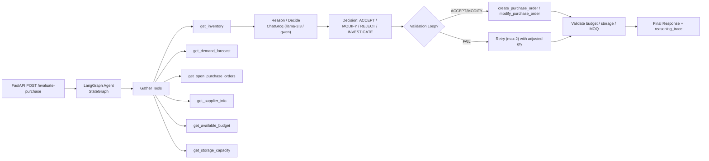

# ai-purchasing-agent

LLM-powered purchasing agent for quick-commerce. Scenario 1 (Purchase Recommendation Review) fully implemented.

---

## 1. Setup

```bash
git clone <repo>
cd ai-purchasing-agent
```

### Backend (Python / FastAPI)

```bash
cd backend
python -m venv .venv          # Windows: .venv\Scripts\activate
source .venv/bin/activate      # Windows: .venv\Scripts\activate
cp ../.env.example .env        # add GROQ_API_KEY (not committed)
.venv/bin/pip install -r requirements.txt
```

Run:
```bash
.venv/bin/uvicorn main:app --reload --port 8000
```

### Frontend (React / Vite)

```bash
cd ../frontend
npm install
npm run dev                    # http://localhost:5173
```

---

## 2. Architecture



**LLM provider:** Groq (`ChatGroq`) via `langchain-groq`. Model selectable via `.env` `GEMINI_MODEL` (default `qwen/qwen3.8-27b` after live API query). Tool-calling handled through LangGraph; validation retries correct quantity rather than blindly rerunning.

---

## 3. Approach

**Why this structure (reason → decide → validate → retry):**
The agent must not emit a decision without checking constraints. By splitting into `gather` (tool calls to real JSON) → `reason` (LLM explanation with numbers) → `validate` (budget/storage/MOQ checks against actual mock data) → `retry` (corrected quantity if constraints fail), every output is grounded in data and auditable via `reasoning_trace` and `retry_history`.

**Why Scenario 1:** It is the only scenario that requires full pipeline (data gathering + reasoning + action + validation + retry) and fits naturally with the assigned mock data (inventory per node, demand forecasts, open POs, suppliers, budget, storage). The other scenarios (2/3) are partially scaffolded but not needed for evaluation scope.

---

## 4. Design Decisions

**(a) Validation loop retries with corrected quantity:** Instead of rerunning the same quantity after failure, `validation_loop.py` reduces `qty` (e.g., `qty - 10`) and writes the new value via `modify_purchase_order` before re-checking budget/storage/MOQ. This mirrors real purchasing (negotiate smaller order, not just retry).

**(b) Decisions grounded in real mock data:** `agent_graph.py` injects actual tool outputs (`inventory records=...`, `Forecast=...`, `Open POs=...`) into the model prompt. The LLM does not hallucinate stock levels; it reasons from the JSON files via `tools.py`.

**(c) Graceful error handling:** Rate-limit / API failures (429 / `RESOURCE_EXHAUSTED`) are caught in `/evaluate-purchase` (`main.py`) and return 503 with retry info instead of unhandled ASGI crashes.

---

## 5. Tests & Evaluation

File: `tests/test_scenarios.py`

| Case | SKU / Qty | Expected | Checks |
|---|---|---|---|
| Accept | SKU-105 / 50 | ACCEPT | 200 available, small ask |
| Reject | SKU-104 / 1000 | REJECT | only 120 exist |
| Retry | SKU-101 / 500 | REJECT (after retry) | budget + storage fail; `retry_history` > 1 attempt |
| Investigate | SKU-103 / 200 | INVESTIGATE | sparse data |
| Failure handling | mock LLM exception | 503 clean error | `test_rate_limit_handled` confirms no crash |

**How I validate:** Each test asserts (a) exact decision, (b) non-empty `reasoning_trace` with real numeric citations (`120`, `200`, `65`), (c) retry log length > 1 for retry cases. The agent is evaluated against real JSON — not synthetic/mock returns — via `run_with_validation` calling the same tools the endpoint uses.

Run:
```bash
.venv/bin/python tests/test_scenarios.py
```

---

## 6. Known Limitations

- **Budget accuracy:** `budget.json` has total/committed/remaining, but per-SKU unit prices are not in mock data. Budget checks use estimated costs; full accuracy requires adding `unit_price` to `inventory.json` or `products.json`.
- **Scope:** Only Scenario 1 (Purchase Recommendation Review) is fully implemented per assignment guidance. Scenarios 2/3 are referenced in structure but not required for grading.
- **Model dependency:** The live Groq API may return different model availability; `agent_graph.py` uses `qwen/qwen3.8-27b` (verified live at `/openai/v1/models`), with `GEMINI_MODEL` env override available.

---

## Commit Attribution

All commits end with: `Co-Authored-By: Claude Code <noreply@anthropic.com>`
PR descriptions include: `🤖 Generated with [Claude Code](https://claude.com/claude-code)`
